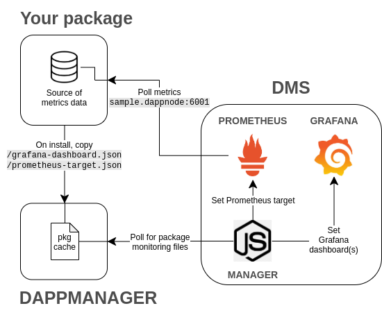

# DMS DAppNode Package

[](http://my.dappnode/#/installer/dms.dnp.dappnode.eth)

**D**AppNode **M**onitoring **S**ervice

This package privately and locally collects and displays metrics related to your dappnode and its packages. Based on Grafana and Prometheus

---


---

## How does it work?

According to the following diagram, the DMS package provides a high level of abstraction, allowing any new DAppNode package developed to easily implement grafana and prometheus.



### Instructions to implement Grafana and Prometheus in your DAppNode package:

- **prometheus-targets.json** file: specifying the domain and the port where the data will be published.
- **name-grafana-dashboard.json** file: specifying the grafana dashboard to be used.

If you want to learn more about how do Grafana and Prometheus work, visit this [link](https://prometheus.io/docs/visualization/grafana/)

## How to add a custom prometheus endpoint

In order to add a custom path to prometheus you need to overwrite the `__metrics_path__` label (by default `/metrics`), so that you can define diferent and specific metrics paths per target, like this:

```
[
    {
        "labels": {
            "package": "tg.turbo-geth.dnp.dappnode.eth",
            "service": "tg.turbo-geth.dappnode",
            "__metrics_path__": "/debug/metrics/prometheus"
        },
        "targets": [
            "tg.turbo-geth.dappnode:6060"
        ]
    }
]
```

## Backup

The package backup (and the DAppNode full backup) includes Grafana's database, `/var/lib/grafana/grafana.db` in the `grafana` service. It holds what users create in Grafana: dashboards, folders, alert rules, contact points, notification policies, silences, users, preferences and other settings.

It does not include the Prometheus metrics history, which starts again from the restore. The Prometheus targets and the manager's state are not included either, because the manager rebuilds them from the installed packages. Plugins installed from the Grafana catalog are not included either: install them again after a restore.

The database is copied while Grafana runs. Grafana writes to it now and then (alert state, sessions, caches), so a backup taken during a write can be inconsistent. For an exact copy, stop the DMS package before you download the backup from its Backup tab (the download works with the package stopped), and start it again afterwards. A restore from the Backup tab needs the package running: it copies the database into the running Grafana and restarts the package. If Grafana does not start after a restore, restore it from another backup.

After a restore, the manager may stop updating the dashboards of packages it had already imported on that node, because it tracks dashboard versions outside the database. Open `http://manager.dms.dappnode/clear-db` to make it import all package dashboards again: edits you made to package dashboards are replaced, and stay in each dashboard's version history.

## Note

This is early stage software and it's just a PoC

## License

This project is licensed under the GNU General Public License v3.0 - see the [LICENSE](LICENSE) file for details
